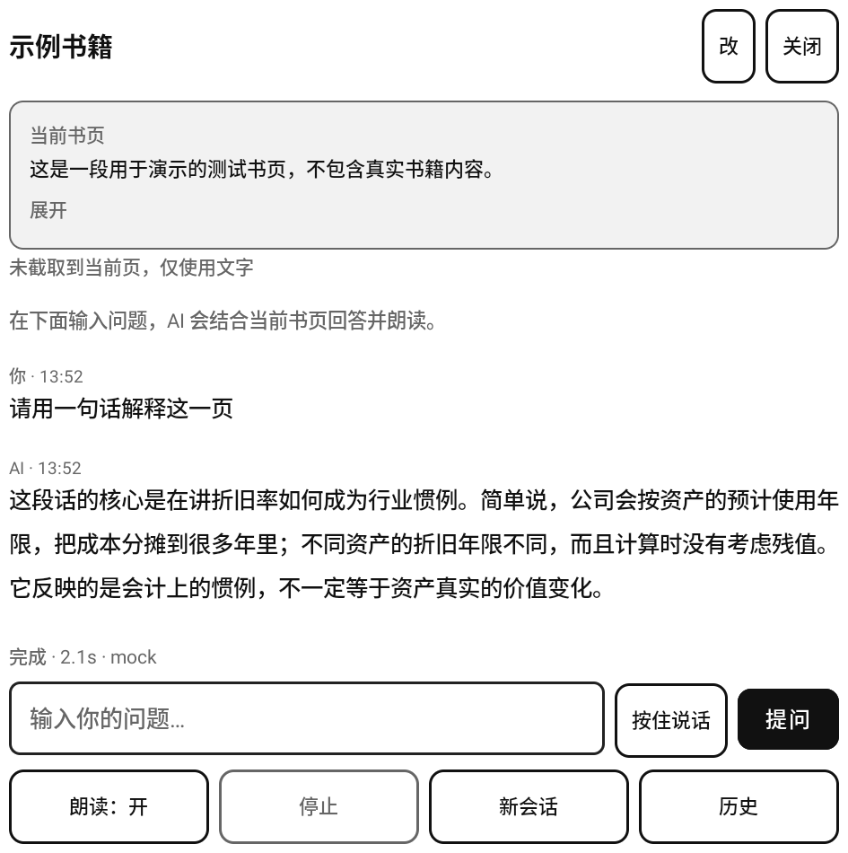
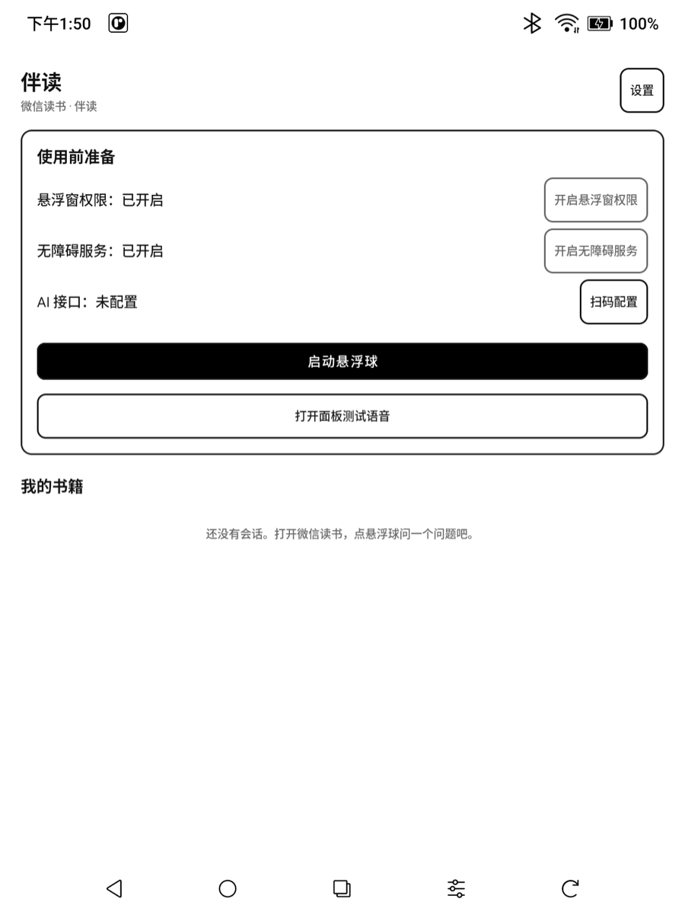
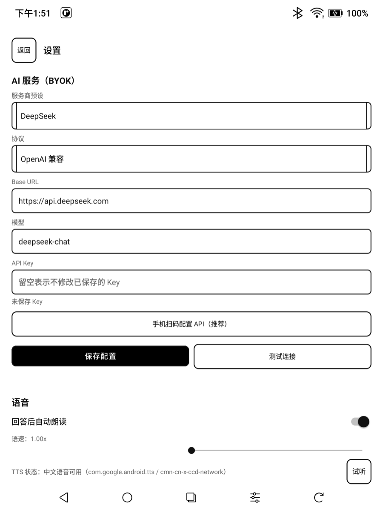
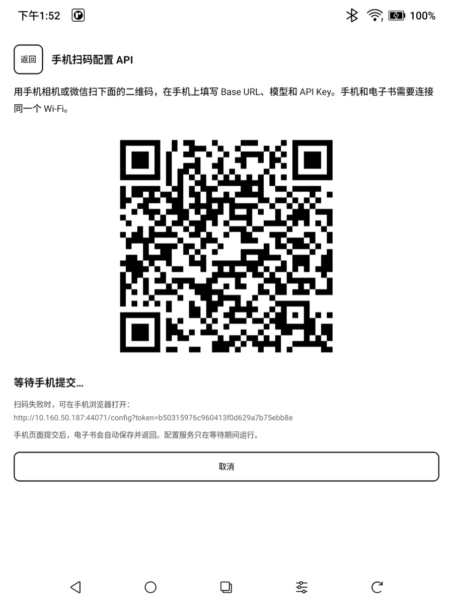
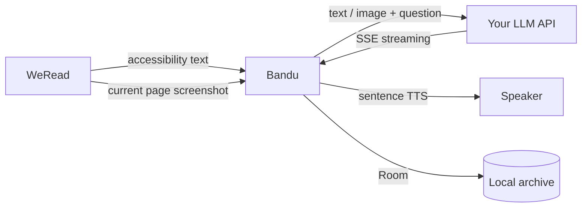

<p align="right"><a href="README.md">简体中文</a> · <b>English</b></p>

# 伴读 (Bandu)

> An AI reading companion for **WeRead (微信读书)** on BOOX e-ink devices. Tap the floating ball to read the current page or capture it and send it to your AI, get a streaming answer (optionally read aloud), and keep conversations archived by book.

<p align="center">
  
</p>



<p align="center"><sub>Panel example (test page)</sub></p>

## Features

- **Floating ball**: draggable and edge-snapping. Tap it to open a small floating panel; closing the panel returns straight to WeRead and the ball comes back.
- **Text + image recognition**: uses accessibility text on text pages; on image, chart, or scanned pages it captures the current page and sends it to a vision-capable model with your question.
- **AI Q&A**: OpenAI-compatible / Anthropic streaming. The model first identifies the book, chapter/paragraph, or figure, then answers.
- **Read aloud**: sentence-by-sentence system TTS with adjustable speed. Off by default; enable it in the panel or Settings.
- **Voice input**: press and hold to talk, reusing the BOOX system ASR (Alibaba Cloud). No ASR key needed.
- **Local archive**: Room database, archived by book → session → message, with history browsing. Each answer shows its question plus the original page text and screenshot from that moment, and individual sessions or whole books can be deleted.
- **QR setup**: the e-reader shows a QR code, and your phone on the same Wi-Fi fills in the API config, so you don't have to type on the e-ink screen.
- **Auto-update**: checks GitHub Releases once a day, or manually from Settings; downloads the APK and hands it to the system installer.
- **Privacy**: no backend, no analytics; the API key is encrypted with Android Keystore.

## Screenshots

<p align="center">
  
  
  
</p>

## Quick start

1. Install the APK (the release build is recommended; the debug build `com.booxai.helper.debug` can be installed alongside it and has an inverted black floating ball with a white mark).
2. Open Bandu and grant "Display over other apps".
3. System Settings → Accessibility → enable "Bandu Reading Assistant".
4. Configure the API:
   - Recommended: tap "QR setup" on the home screen, connect the phone and the e-reader to the same Wi-Fi, and scan the code to enter the Base URL, model, and API key.
   - You can also fill them in manually under "Settings".
5. On a WeRead reading page, tap the "伴读" floating ball, type your question, and tap "Ask".

## Image / chart recognition

- The current screen is captured when you tap the floating ball. "Attach current page screenshot" in the panel is checked by default and hidden automatically when no screenshot was captured.
- Image, chart, and scanned pages are sent to the AI together with your question; the AI first identifies the current book, chapter/paragraph, or figure, then answers.
- A vision-capable model is required, such as **GPT-4o, Claude, or Qwen-VL**. For text-only models, uncheck the screenshot option or let the app fall back automatically.
- If the model does not support images, the app removes the screenshot and retries with text only, with a hint in the status bar.
- Screenshots are saved with the question in the app's private storage so you can review them later; they are deleted together with the session or book.

## Workflow



## Supported APIs

- **OpenAI-compatible**: DeepSeek, Qwen (DashScope compatible mode), Kimi, Zhipu GLM, OpenAI, and any compatible gateway.
- **Anthropic**: Claude.
- Enter the Base URL prefix before `/chat/completions` or `/v1/messages`; the app appends the path automatically.
- Image recognition requires the model itself to support visual input.

## Build

Requires JDK 17 and Android SDK 34; the Gradle wrapper downloads Gradle 8.10.2.

```bash
export JAVA_HOME=/path/to/jdk17
export ANDROID_HOME=$HOME/Library/Android/sdk
./gradlew :app:assembleDebug
```

Release build (requires signing files):

```bash
./gradlew :app:assembleRelease
```

> A locally built release APK uses the local keystore and is for local testing only; official releases are built by CI. The local `keystore/readask-release.jks` is the old key and cannot upgrade an installed 1.0.0.

### GitHub Actions

- Pushing to `main` builds the debug APK automatically: Actions artifact `reader-helper-debug`, also pushed to the `build-artifacts` branch.
- Run **Android Release Build** manually to build the release package. Repository Secrets required:
  - `ANDROID_KEYSTORE_BASE64`
  - `ANDROID_KEYSTORE_PASSWORD`
  - `ANDROID_KEY_ALIAS`
  - `ANDROID_KEY_PASSWORD`

If the keystore and properties already exist locally, write all secrets with one command (values are not printed):

```bash
tools/setup_release_secrets.sh /path/to/readask-release.jks /path/to/keystore.properties
```

After a successful release build, a **GitHub Release** is created or updated automatically (tag `v<version>`), and these are kept:

- GitHub Release assets: `reader-helper-release.apk` and `update.json` (used by the in-app updater; no need to download it manually)
- Actions artifact: `reader-helper-release`
- `release-artifacts` branch

Release downloads: <https://github.com/ricardochen1996/ebook-helper/releases>

## Signing

- Release builds are signed by CI with the keystore stored in repository Secrets. Current certificate SHA-256:

  ```
  1b13719e3ebc5e4e86f08a69250681d7f52cefbea19cef928d22616f9adec8ed
  ```

- The signing key was regenerated on 2026-11-09 (the old keystore was lost). The local `keystore/readask-release.jks` is the pre-rotation key: do **not** use it with `tools/setup_release_secrets.sh`, or users on 1.0.0 will be unable to install the update (they would have to uninstall and lose their sessions).
- `android-release.yml` asserts that the CI-built APK has the certificate above and aborts the release on a mismatch.
- Back up the CI keystore and password; if lost again, upgrading still requires uninstalling and reinstalling.

## FAQ

**The floating ball disappeared / the app won't open?**  
BOOX EAC may freeze third-party apps automatically. Go to Settings → App management → Bandu and disable "auto freeze / app optimization", or run `adb shell pm enable com.booxai.helper`.

**The notification says "Bandu is running" but there is no floating ball on screen?**  
The floating ball is temporarily hidden while the Q&A panel is open; the notification then says "Q&A panel is open, floating ball temporarily hidden". It comes back when the panel closes or goes to the background. The service also self-checks periodically and re-attaches the overlay if the system removed it; if overlay permission is revoked, the service stops and the notification disappears. If it still does not come back, reopen the app and tap "Start floating ball".

**Accessibility shows enabled but not connected?**  
Turn "Bandu Reading Assistant" off and on again in system accessibility settings; reboot the device if necessary.

**Cannot connect to the server?**  
Check Wi-Fi, system proxy, and the Base URL; use "Settings → Test connection" to narrow it down first.

**Press-and-hold voice input does nothing?**  
System ASR uses the BOOX account and voice quota; check login, quota, and network. You can also tap the input field and use the keyboard's voice dictation.

**An image page used to say "Please open WeRead"?**  
Since 0.1.2+, image/chart pages are captured and sent with the question automatically; make sure WeRead is in the foreground and the accessibility service has not been frozen by the system.

**The model does not support images?**  
Switch to a vision-capable model, or uncheck "Attach current page screenshot"; the app also falls back to text automatically.

**Accessibility stops working after an APK update?**  
Android revokes accessibility authorization after an over-the-top install; enable it again.

## Updates

- 1.0.0 and earlier have no updater module, so install 1.1.0 manually once; after that you can check for and install later versions in the app.
- The app checks GitHub Releases once a day on launch, or manually via Settings → About → Check for updates.
- When a new version is found the app shows a prompt; after you confirm, it downloads the APK and opens the system installer. The first time, allow "install unknown apps" for Bandu in system settings. Automatic checks can be turned off under Settings → About.
- Downloads are verified with SHA-256. Updates keep your books and sessions, but you need to re-enable the accessibility service after installing.

## Privacy

- The current page text/screenshot is sent to your configured AI endpoint only when you tap "Ask"; the app has no backend and collects no data.
- Screenshots are stored in the app's private directory and archived with the message for later review; deleting a session or book deletes the corresponding files, and nothing is written to the public gallery.
- The API key is encrypted with Android Keystore; `allowBackup=false`.
- The accessibility service only listens to `com.tencent.weread.eink`; QR setup starts a one-time LAN server only while waiting.
- Use QR setup only on a trusted Wi-Fi network, and follow WeRead's terms of service.

## Known limitations

- WeRead updates may change the accessibility structure; screenshot recognition can serve as a fallback, but text extraction may need adaptation.
- Image recognition depends on whether the selected model supports visual input.
- E-ink refresh is slow; streaming text is throttled and the UI has no animations.
- Voice recognition reuses an undocumented BOOX interface and may break after a firmware update.

## Development

```bash
# mock LLM
python3 tools/mock_llm_server.py 8765
adb reverse tcp:8765 tcp:8765

# debug build
adb install -r app/build/outputs/apk/debug/app-debug.apk
```

The debug build `com.booxai.helper.debug` can use `DebugConfigActivity` over adb to write config, open the QR setup page, and test text extraction. Its floating ball is inverted (black with a white mark) and its notification is marked "debug", so it is easy to tell apart from the release build.
