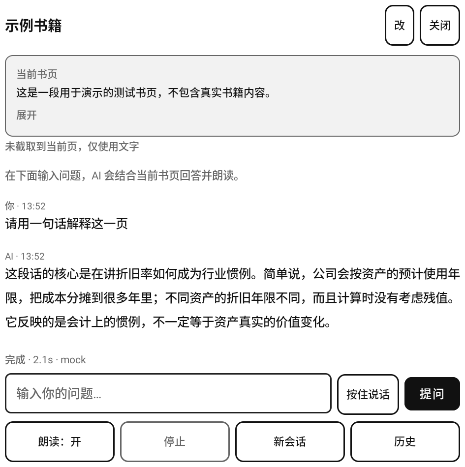
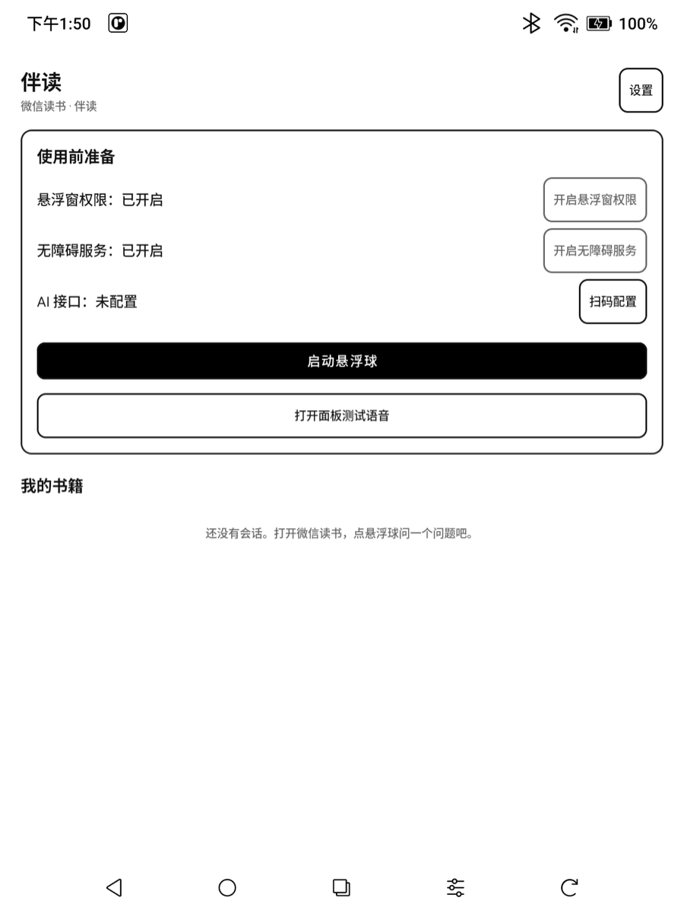
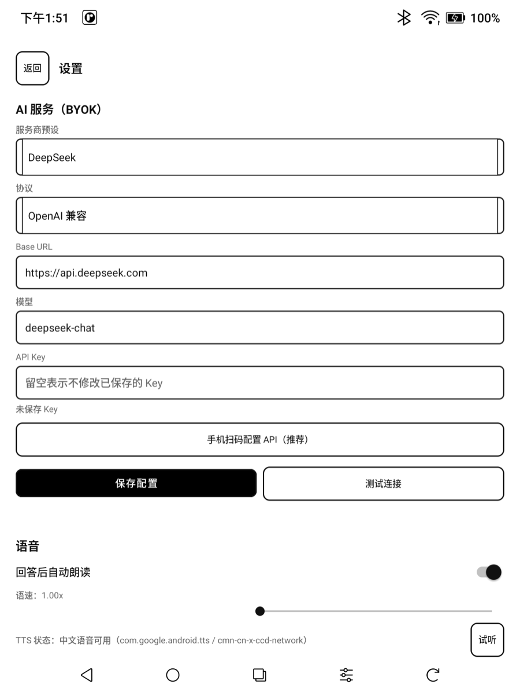
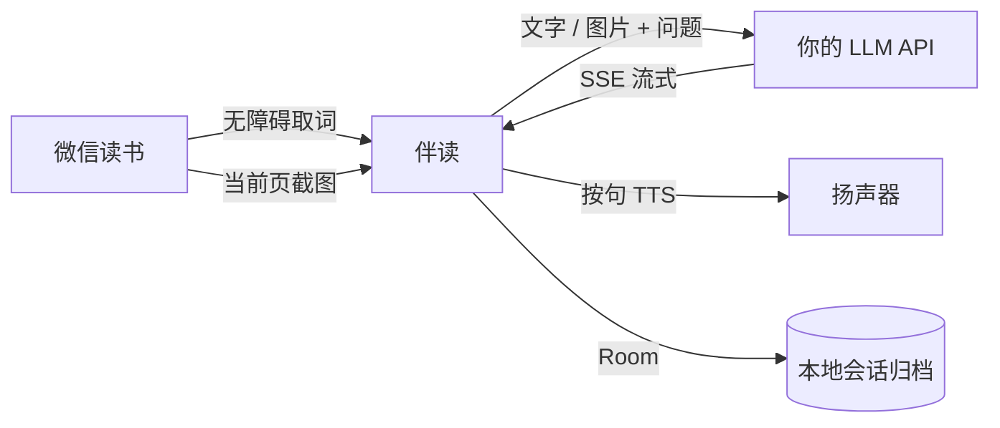

<p align="right"><b>简体中文</b> · <a href="README.en.md">English</a></p>

# 伴读

> 在文石 BOOX 上给**微信读书**用的 AI 伴读：点悬浮球，读取当前页文字或截取当前页发给 AI，流式回答（可选朗读），会话按书归档。

<p align="center">
  
</p>



<p align="center"><sub>浮窗示例（测试书页）</sub></p>

## 功能

- **悬浮球**：可拖动、贴边；点开一个浮动小窗，关闭直接回到微信读书，悬浮球恢复。
- **文字 + 图片识别**：文字页用无障碍取词；图片、图表、扫描页自动截取当前页，随问题发给支持视觉的模型。
- **AI 问答**：OpenAI 兼容 / Anthropic 流式输出；先定位书籍、章节/段落或图表，再回答问题。
- **朗读**：系统 TTS 按句流式朗读，可调语速；默认关闭，可在面板或设置中开启。
- **语音提问**：按住说话，复用文石系统 ASR（阿里云），不需要 ASR Key。
- **本地归档**：Room 数据库，按书 → 会话 → 消息归档，可回看；每条回答带对应问题和当时的书页原文/截图，支持删除单条会话或整本书。
- **扫码配置**：电子书显示二维码，手机在同一 Wi-Fi 下填写 API 配置，不用在墨水屏上敲字。
- **自动更新**：每天自动检查 GitHub Release，也可在设置里手动检查；下载后调用系统安装器覆盖安装。
- **隐私**：无后端、无统计；API Key 用 Android Keystore 加密。

## 截图

<p align="center">
  
  
  
</p>

## 快速开始

1. 安装 APK（正式包优先；debug 包 `com.booxai.helper.debug` 可与正式包并存，悬浮球为反色黑底白标）。
2. 打开「伴读」，授予「显示在其他应用上层」。
3. 系统设置 → 无障碍 → 开启「伴读阅读助手」。
4. 配置 API：
   - 推荐：首页点「扫码配置」，手机和电子书连接同一个 Wi-Fi，扫码填写 Base URL、模型、API Key。
   - 也可以在「设置」里手动填写。
5. 微信读书阅读页点「伴读」悬浮球，输入问题，点「提问」。

## 图片 / 图表识别

- 点悬浮球时会截取当前屏幕；面板里的「附带当前页截图」默认勾选，没有截到图时自动隐藏。
- 图片、图表、扫描页会连同问题一起发给 AI；AI 会先判断当前书籍、章节/段落或图表，再回答。
- 需要支持视觉的模型，例如 **GPT-4o、Claude、Qwen-VL** 等；普通文字模型请关闭截图开关，或让 App 自动回退。
- 模型不支持图片时，App 会自动去掉截图、改用文字重试，并在状态栏提示。
- 截图会随这次提问保存在 App 私有目录，用于会话回看；删除会话/书籍时一并删除。

## 工作流程



## 支持的接口

- **OpenAI 兼容**：DeepSeek、通义千问（DashScope 兼容模式）、Kimi、智谱 GLM、OpenAI、任意兼容中转站。
- **Anthropic**：Claude。
- Base URL 填到 `/chat/completions` 或 `/v1/messages` 之前的前缀；App 自动拼接路径。
- 图片识别需要模型本身支持视觉输入。

## 构建

需要 JDK 17、Android SDK 34，Gradle Wrapper 会下载 Gradle 8.10.2。

```bash
export JAVA_HOME=/path/to/jdk17
export ANDROID_HOME=$HOME/Library/Android/sdk
./gradlew :app:assembleDebug
```

正式包（需要签名文件）：

```bash
./gradlew :app:assembleRelease
```

> 本地构建的正式包使用本地 keystore 签名，只能自测；正式发布以 CI 为准。本地 `keystore/readask-release.jks` 是旧 key，无法覆盖已安装的 1.0.0。

### GitHub Actions

- 推送 `main` 自动构建 debug APK：Actions artifact `reader-helper-debug`，同时推送到 `build-artifacts` 分支。
- 手动运行 **Android Release Build** 构建正式包，需要仓库 Secrets：
  - `ANDROID_KEYSTORE_BASE64`
  - `ANDROID_KEYSTORE_PASSWORD`
  - `ANDROID_KEY_ALIAS`
  - `ANDROID_KEY_PASSWORD`

本机已有 keystore 和 properties 时，一条命令写入（值不会打印；脚本会校验证书指纹，旧 key 会被拒绝）：

```bash
tools/setup_release_secrets.sh /path/to/readask-release.jks /path/to/keystore.properties
```

正式包构建成功后会自动创建/更新 **GitHub Release**（tag `v版本号`），同时保留：

- GitHub Release asset：`reader-helper-release.apk`、`update.json`（App 更新检查用，无需手动下载）
- Actions artifact：`reader-helper-release`
- `release-artifacts` 分支

Release 下载页：<https://github.com/ricardochen1996/ebook-helper/releases>

## 签名

- 正式包由 CI 使用仓库 Secrets 中的 keystore 签名；当前证书 SHA-256：

  ```
  1b13719e3ebc5e4e86f08a69250681d7f52cefbea19cef928d22616f9adec8ed
  ```

- 2026-11-09 重新生成过签名（旧 keystore 丢失）。本地 `keystore/readask-release.jks` 是重新生成前的旧 key，**不要**用它运行 `tools/setup_release_secrets.sh` 覆盖 CI Secrets，否则已安装 1.0.0 的用户无法覆盖安装（只能卸载重装并丢失会话）。
- `android-release.yml` 会校验 CI 产物的证书指纹必须等于上面的值，不匹配就中止发布。
- 请备份 CI 使用的 keystore 和密码；丢失后再次升级仍需卸载重装。

## 常见问题

**悬浮球消失 / App 打不开？**  
文石 EAC 可能自动冻结第三方 App。到「设置 → 应用管理 → 伴读」关闭「自动冻结/应用优化」，或执行 `adb shell pm enable com.booxai.helper`。

**通知栏显示“伴读正在运行”，页面上却没有悬浮球？**  
打开问答面板时悬浮球会暂时隐藏，此时通知栏会提示「问答面板已打开，悬浮球暂时隐藏」；面板关闭或退到后台后会自动恢复。服务也会定时自检，悬浮窗被系统移除后重新挂载；如果悬浮窗权限被收回，服务会停止，通知也会消失。仍不恢复时，重新打开 App 点「启动悬浮球」。

**无障碍显示已授权但未连接？**  
到系统无障碍设置里把「伴读阅读助手」关闭再开启；必要时重启设备。

**提示无法连接服务器？**  
检查 Wi-Fi、系统代理和 Base URL；先在「设置 → 测试连接」定位问题。

**按住说话没反应？**  
系统 ASR 使用文石账号和语音额度；检查登录、额度和网络。也可以点输入框用键盘麦克风听写。

**图片页以前提示“请打开微信读书”？**  
更新到 0.1.2+ 后，图片/图表页会自动截屏并随问题发送；确保当前前台是微信读书，无障碍服务未被系统冻结。

**模型不支持图片？**  
换成支持视觉的模型，或关闭「附带当前页截图」；App 也会自动回退纯文字。

**更新 APK 后无障碍失效？**  
Android 会在覆盖安装后撤销无障碍授权，重新开启一次即可。

## 更新

- 1.0.0 及更早版本没有更新模块，需要手动安装一次 1.1.0；之后即可在 App 内检查并安装后续版本。
- 打开 App 时每天自动检查一次 GitHub Release；也可以在「设置 → 关于 → 检查更新」手动检查。
- 发现新版本后弹窗提示，确认后下载 APK 并调用系统安装器完成覆盖安装。首次使用需要在系统设置里允许「伴读」安装未知应用；自动检查可在「设置 → 关于」关闭。
- 下载包会校验 SHA-256；更新不会清除书籍和会话，但覆盖安装后需要重新开启一次无障碍服务。

## 隐私

- 只在你点「提问」时发送当前页文字/截图到你配置的 AI 接口；App 没有后端，不收集数据。
- 截图保存在 App 私有目录并随消息归档，用于回看；删除会话/书籍时删除对应文件，不写入公开相册。
- API Key 使用 Android Keystore 加密，`allowBackup=false`。
- 无障碍服务只监听 `com.tencent.weread.eink`；扫码配置只在等待期间开启一次性局域网服务。
- 请只在可信 Wi-Fi 下使用扫码配置，并遵守微信读书服务条款。

## 已知限制

- 微信读书升级可能改动无障碍结构；截图识别可以兜底，但取词逻辑可能需要适配。
- 图片识别依赖所选模型是否支持视觉输入。
- 墨水屏刷新较慢，流式文本按节流更新，App 界面无动画。
- 语音识别复用文石未公开接口，固件升级可能失效。

## 开发调试

```bash
# mock LLM
python3 tools/mock_llm_server.py 8765
adb reverse tcp:8765 tcp:8765

# debug 包
adb install -r app/build/outputs/apk/debug/app-debug.apk
```

debug 包 `com.booxai.helper.debug` 可用 `DebugConfigActivity` 通过 adb 写入配置、打开扫码配置页、测试取词。debug 包的悬浮球是反色（黑底白标），通知栏也带「调试」标记，方便和正式包同时安装时区分。
